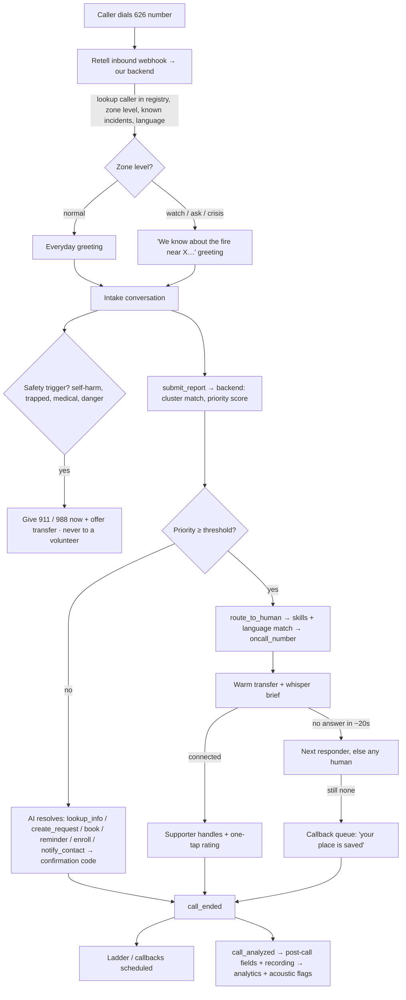

# DIZA — End-to-End Workflow

Five loops make up the product. Then section 6 covers how the team builds it.

## 1. Inbound call (the core loop)



**In words:**
1. The phone rings. Retell asks our backend who's calling and what the current situation is.
2. The agent greets the caller according to their zone's level.
3. It takes the details and reports them to our backend.
4. The backend matches the report to known incidents and scores its priority.
5. Then one of four things happens:
   - The AI **does the task itself**: creates a request, books a slot, sets a reminder, enrolls someone in check-ins, or calls a family member.
   - It **hands off to the best-matched human** with a whispered brief.
   - It **saves the caller's place** for a callback.
   - It gives **911/988 immediately**.
6. Everything is logged for analytics.

## 2. Outbound calls (scheduler)

```
Scheduler (APScheduler) ──► create-phone-call (Retell) with resident's variables
   sources: Tuesday check-ins · reminders · callbacks owed · welfare calls (crisis) · notify_contact
   └► call_ended.disconnection_reason
        answered        → done (+ acoustic baseline update, health-change flag → supporter)
        no answer/busy/voicemail → ladder: SMS (verified phones only) → retry +5 min → emergency contact → RED flag for human welfare check
```

## 3. Zone escalation (the mode switch)

```
reports + call volume per zone ──► compare vs. everyday baseline
  spike or N independent reports or official feed ─► WATCH  (auto)  greeting changes, supporter paged
  cluster keeps growing                               ─► ASK    (auto)  corroboration calls to neighbours, alert drafted
  human taps Declare                                  ─► CRISIS (human) welfare call-down, alert sent for approval
  nobody acknowledges page in ~5 min at ASK           ─► auto welfare calls to highest-risk residents only
  human only                                          ─► STAND-DOWN → "all clear" check-ins
```

## 4. Supporter workflow (mobile web app)

```
Go on duty (skills, languages) → incoming transfer rings phone + brief on screen
→ handle call → one-tap rating (urgent? right skill? resolved?)
→ request queue: accept escort / ticket / callback → mark done (caller can check_status by code)
```

## 5. Learning loop (data → better app)

```
calls + labels + drill ground truth
 ├► baselines            → Watch trigger thresholds
 ├► topic clustering     → new FAQ drafted → human approves → Retell knowledge base
 ├► triage calibration   → priority weights / thresholds (optimise urgent recall)
 ├► routing stats        → matching weights + staffing gaps
 ├► failure mining       → prompt fixes (versioned in agents/)
 └► voice baselines      → per-resident health-change flags
 → weekly "Community Pulse" digest for the customer
```

## 6. How the team works

**Repo and branches**
- `main` must always demo. Each person works on a feature branch (`cs1/agent-transfer`, `ds/clustering`, etc.) and merges with a small PR. CS#2 reviews backend changes; CS#1 reviews agent changes.
- `agents/` holds the Retell prompts and function schemas as files. A script pushes them to Retell via the API, so **every prompt change is a commit**. That gives us twist proof and before/after comparisons for free.
- Secrets live in `.env`, never committed.

**Interfaces (agree tonight, so everyone can work in parallel)**
- Supabase tables: `residents`, `responders`, `calls`, `call_events`, `reports`, `clusters`, `zones`, `requests`, `labels`, `drill_cards`
- Function contracts: the arguments and return shape of each Retell function (see SETUP.md)
- DS works on synthetic data against the same tables until the real calls flow.

**Cadence**
- **Stand-ups (5 min):** Fri 11 PM, Sat 9 AM, 1 PM, 5 PM, 8:30 PM. Each person says: done / next / blocked.
- **Twist protocol** (11:30 PM, 4:30 AM, 7:00 AM):
  1. read
  2. 15-min huddle
  3. pick one build change
  4. implement on a branch
  5. add a `TWISTS.md` entry (twist, what changed, why, commit link, 20-second clip)
  6. respond within 6 hours
- **Flood cycle:** pre-flight check → flood → metrics snapshot → fix list → ship before the next flood.

**Timeline**
- **Fri → 11:30 PM:** thin slice. Call → report on the dashboard.
- **Overnight:** functions, routing, transfer, outbound and ladder. Sleep shifts as in PLAN.md.
- **Sat 10 AM:** internal test done → **Open Line opens 11 AM**.
- **12:30 PM:** Flood #1 → fixes.
- **2 PM:** feature freeze for P0/P1.
- **3:30 PM:** Surge Drill. Record the demo video.
- **4–8 PM:** analytics + Insights tab, deck, Devpost write-up.
- **8 PM:** Flood #3 (before/after).
- **9 PM:** submit (hard deadline 10 PM).
- **Sun 9 AM:** finalist deck / confirm demo → live floods on the demo floor or during the pitch.

**Who's on what**

| | Builds | Runs during the event |
|---|---|---|
| CS#1 | Retell agents, functions, transfers, outbound, prompts | Retell console, live agent fixes |
| CS#2 | Backend, Supabase, dashboard, supporter app, scheduler, simulator | Infra + dashboard on the big screen |
| DS | Clustering, priority score, baselines, topic mining, drill cards, metrics | Snapshots, before/after numbers |
| Biomech | Physiological voice flags, medical skill taxonomy, fatigue rules | Recruiting callers and supporters, posters, deck, video, Devpost, TWISTS.md |
